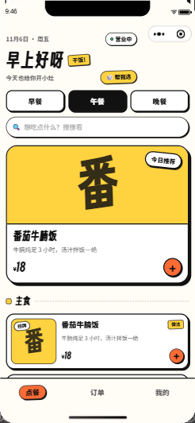
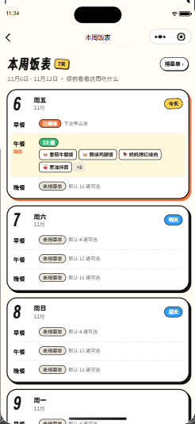

# 开饭咯 · 点单小程序

> 线上小程序名称：**张饱饭堂**（项目代号：开饭咯）

一个只有一口锅的私厨点单小程序：**她点单，你掌勺。**

给女朋友点早餐 / 午餐 / 晚餐用的微信小程序，也可以作为对外开放点单产品的起点。
视觉走「多巴胺潮玩 / 新丑风」：米白底、高饱和色块、4rpx 黑描边、硬投影、贴纸元素。




---

## 当前状态

- v0.2.0 · 家庭投喂版
- **默认接入微信云开发**；把 `miniprogram/config.ts` 里的 `USE_CLOUD` 改成 `false` 即可切回本地 mock 数据
- 已实现：今日菜单、餐次切换、今天/明天快捷日期、菜品搜索（含分类名与搜索历史）、帮我选、首页避开忌口筛选、菜品收藏（规格弹层 ♡、首页筛选、独立收藏页、分类筛选、最近/价格排序、收藏海报）、卡通菜品插画（按菜名生成 SVG，可上传图片覆盖，上传前自动压缩、加载失败回退 emoji）、菜品做法（点单时展开查看步骤，菜谱页可逐步勾选并查看食材、过敏原与近 90 天点单/评分）、菜品成本与单份毛利、库存快捷 ±、菜谱与菜品海报、菜品详情 / 加料弹层、购物车（按餐次 + 日期分开，独立购物车页可分组改数量/清空/逐组结算）、结算下单（备注快捷短语、按目标日期/餐次校验供应、厨房忙闲与预计出锅提示）、订单列表（菜品缩略图、最新留言、全部 / 进行中 / 已结束 + 餐次筛选、待评价筛选、订单号 / 菜名 / 日期 / 备注 / 评价搜索、已评/已回复/预订标记）、订单状态时间轴（每步等待时长）、订单留言板（快捷短语、未读标记）、菜品过敏原快照、催单、再来一单、开火前改整单备注、复制订单小票、订单评价（😋/🙂/😵 + 快捷标签 + 留言 + 晒图）与掌勺人回复、我的评价回顾（可按有图筛选）、干饭足迹（连吃天数 / 成就徽章）、首页本周干饭小结（可进足迹）、首页「今天这单」（含最新留言）「上次吃」快捷入口、首页重要日子提醒（可跳饭表提前安排）、本周饭表（今天起 7 天早/午/晚安排与休息日，可直接预订，可生成图片分享）、厨房端（接单 / 订单过敏原与最新留言 / 一键全部接单 / 全部开火出锅完成 / 状态流转 / 新订单轮询提醒 / 今日待办 / 今日营收目标进度 / 未来 30 天生日与纪念日提醒 / 今日备菜按餐次汇总（含过敏原）与食材采购清单（整单/单餐复制 / 生成图片）/ 今日小结复制与图片分享 / 近 7 天统计 / 经营月报（近 7/30 天、周对比、上月同期、评价标签排行（可点进历史订单）、好评菜品榜、滞销菜品榜（可点进菜谱 / 一键售罄）、成本毛利、数据体检（含缺成本）跳转、当前区间订单 CSV 复制/文件分享、菜品销量 CSV 复制/文件分享、全量 JSON 备份）/ 历史订单搜索、餐次/日期/评分筛选 / 看全部 / 筛选结果 CSV / 评价回复与待回复筛选（差评优先） / 订单搜索与餐次筛选 / 订单小票预览、复制与图片分享 / 未来预订区 / 菜品 CRUD 与一键复制 / 菜品模板库（136 道，可只看未添加、记住分类）与批量导入（可选成本列、内置示例） / 菜品搜索与分类/状态/缺做法筛选 / 批量上下架 / 批量改分类 / 批量补库存 / 按筛选结果批量百分比改价（只改价格，不覆盖图片/状态） / 分类管理 / 库存与低库存一键补货 / 营业设置（开关 / 截单 / 今日公告与起止日期 / 推荐角标 / 低库存阈值 / 今日与本月营收目标 / 指定休息日 / 每周固定休息）/ 每日菜单编排、菜单模板及一键复制到未来 7 天）、管理员权限、云数据库初始化、订阅消息、内容安全检测、未来 7 天预订、订单取消（可填原因）、许愿池（状态筛选）、爱心券（过期时间与快过期提醒）、口味与档案（忌口、地址、生日与纪念日）、今日看板、分享、隐私说明页
- 未实现：微信支付、小票打印（见路线图）

> **云函数部署提示**：如果「上传并部署」报
> `getCloudAPISignedHeader failed: {"base_resp":{"ret":1000,"errmsg":"system error."}}`，
> 这是微信侧签名服务异常，与代码和配额无关。可以稍后重试，或在云开发控制台重新上传
> `cloudfunctions/api`（云端安装依赖）。部署后用 `node scripts/cloud-call.js getBusiness` 验证。

## 快速开始

1. 下载并打开[微信开发者工具](https://developers.weixin.qq.com/miniprogram/dev/devtools/download.html)
2. 选择「导入项目」，目录选本仓库根目录
3. 填入自己的小程序 AppID（修改 `project.config.json` 的 `appid`）。
   注意：云开发需要真实 AppID，测试号 / 游客模式不支持
4. 按「云开发接入」完成环境配置和云函数部署
5. 点击编译，进入「我的 → 云环境初始化」

只想先看界面、不接云开发：把 `miniprogram/config.ts` 的 `USE_CLOUD` 改为 `false`，直接编译即可。

## 云开发接入（默认开启）

所有业务都通过单个云函数 `cloudfunctions/api` 按 action 路由，客户端不直接读写数据库。

### 首次部署

1. **开通云开发**：在微信开发者工具顶部点击「云开发」，创建环境（新用户有免费期）
2. **填环境 ID**：把环境 ID 填到 `miniprogram/config.ts` 的 `CLOUD_ENV`；如果账号下只有一个环境，也可以留空
3. **部署云函数**：在开发者工具里右键 `cloudfunctions/api` → **上传并部署：云端安装依赖**
4. **初始化数据库**：编译小程序 → 「我的」→「云环境初始化」。
   第一次点击的账号会自动成为管理员，并写入 5 个分类、14 道默认菜品
5. **设置集合权限**：到云开发控制台 → 数据库，把 `categories`、`dishes`、`orders`、`config`、`wishes`、`users`、`coupons`、`menus` 的权限设为「所有用户不可读写」。
   所有读写都走云函数，客户端无需直接访问。新增集合会在对应功能首次使用时自动创建；没有出现就手动建一下

> 如果初始化提示集合不存在，在云开发控制台手动创建 `categories`、`dishes`、`orders`、`config` 四个基础集合，再点一次初始化即可。

### 自动化辅助（可选）

如果习惯用命令行，可以在开发者工具开启自动化端口后，直接用脚本完成数据库初始化：

```bash
cli auto --project "D:\Code\cook" --auto-port 9420
node scripts/init-cloud-db.js ws://127.0.0.1:9420
```

端口以 `cli auto` 的实际输出为准（被占用时会顺延，例如 9421）。

### 管理员

- 第一个执行初始化的账号自动成为管理员
- **更稳妥的做法**：在云开发控制台给 `api` 云函数配置环境变量
  `ADMIN_OPENIDS=<openid1>,<openid2>`，之后只认这个列表里的管理员，
  即使数据库重置也不会变；不配置时保持「第一个初始化的人成为管理员」的私用逻辑
- 「我的 → 我的 openid」可以一键复制当前账号的 openid
- 添加更多管理员：云开发控制台 → 数据库 → `config` 集合 → `app` 文档 → 在 `adminOpenids` 数组里追加 openid（或直接维护 `ADMIN_OPENIDS`）
- 非管理员看不到入口，云函数也会二次校验；厨房端和订单状态操作都会拒绝越权请求

### 数据集合

| 集合 | 内容 |
|---|---|
| `categories` | 分类（主食 / 小炒 / 汤羹 / 饮品 / 甜品） |
| `dishes` | 菜品、价格、规格、加料、售罄状态 |
| `orders` | 订单（含 `_openid`、状态、时间轴、日期、地址、口味快照、评价与掌勺人回复） |
| `config` | 初始化标记、管理员 openid、订单序号、营业设置 |
| `wishes` | 许愿池 |
| `users` | 口味、忌口、常用地址档案（文档 ID 为 openid） |
| `coupons` | 爱心券 |
| `menus` | 每日菜单（文档 ID 为 `date_meal`） |
| `stock_logs` | 菜品库存变动记录（下单扣减 / 取消回补 / 手动调整） |

订单金额和菜品单价由云函数按数据库中的菜价重新计算，不信任客户端传值；售罄菜品会被拒绝。

数据量变大后建议在云开发控制台加这些索引（集合 → 索引管理）：

- `orders`：`_openid`（升序）+ `createdAt`（降序）
- `orders`：`_openid`（升序）+ `requestId`（升序，下单幂等去重）
- `orders`：`_openid`（升序）+ `scheduledDate`（升序）+ `status`（升序）
- `orders`：`status`（升序）+ `scheduledDate`（升序）
- `orders`：`status`（升序）+ `createdAt`（降序）
- `orders`：`createdAt`（降序）、`scheduledDate`（升序）
- `dishes`：`sort`（升序）
- `stock_logs`：`dishId`（升序）+ `createdAt`（降序）
- `coupons`：`owner`（升序）

### 每日菜单自动滚动

`api` 云函数带一个定时触发器 `dailyMenuRoll`（每天 04:00）：会把当天的菜单复制到第二天，只补空缺、不覆盖已经排好的安排；同时把「已售罄」的菜品恢复为供应中，新的一天重新开卖（手动「下架」的菜不受影响；库存为 0 的菜仍显示售罄，需要先补库存）。**CLI 部署不会自动上传触发器**，需要在开发者工具里右键 `cloudfunctions/api` → 「上传触发器」一次；不需要的话删掉 `cloudfunctions/api/config.json` 里的 `triggers` 即可。

即使触发器没有生效（例如没上传触发器），管理员每天第一次打开厨房页时，客户端也会调用一次 `rollMenu` 补跑同样的逻辑。

### 免费额度提示

云开发免费套餐的数据库读操作额度是 **5 万次/天**，按自然日重置（次日 0 点恢复）。厨房页会轮询新订单（有未完成订单时 20 秒一次，空闲时 45 秒一次；为省额度，只拉订单，菜品和统计 5 分钟才刷一次），长时间挂在厨房页仍会消耗读取次数。额度用尽后云函数会返回 `EXCEED_REQUEST_LIMIT / OutOfReadRequestQuota`，客户端会提示「今天的云端读取额度用完了」；个人使用一般够用，对外开放前建议升级套餐。若次日仍报同样的错误，可能是平台限流未及时解除，需要在云开发控制台提交工单。

### 云函数动作

`getCategories` / `saveCategory` / `moveCategory` / `deleteCategory` / `getDishes` / `getDish` / `getOrders` / `getOrdersPage` / `getLastOrder` / `getMyActiveOrder` / `getMyPendingReviewCount` / `getAllOrders` / `getActiveOrders` / `acceptPendingOrders` / `getOrder` /`createOrder` / `cancelOrder` / `updateOrderNote` / `updateOrderSlot` / `urgeOrder` / `rateOrder` / `replyRating` / `updateOrderStatus` / `sendOrderMessage` / `toggleDishStatus` / `saveDish` / `deleteDish` / `moveDish` /
`getBusiness` / `updateBusiness` / `getMenuForDate` / `getWeekMenus` / `saveMenu` / `deleteMenu` / `rollMenu` / `getMenuTemplates` / `saveMenuTemplates` /
`getMyProfile` / `saveMyProfile` / `getSpecialDays` / `getStats` / `getKitchenReport` / `getKitchenStatus` / `getDishSales` / `getDishStats` / `getStockLogs` / `getMyStats` / `createWish` / `getWishes` / `updateWish` / `deleteWish` /
`createCoupon` / `getCoupons` / `getMyExpiringCoupons` / `claimCoupon` / `useCoupon` / `releaseCoupon` / `deleteCoupon` / `exportData` / `getMe` / `initDb`

### 订阅消息

当前已在「张饱饭堂」小程序中开通订阅消息，并配置好两个一次性订阅模板（类目：工具 > 预约/报名）：

| 用途 | 模板 | 字段 |
|---|---|---|
| 新订单提醒（发给管理员） | 顾客下单提醒 | `thing11` / `number2` / `amount3` / `thing4` / `time36` |
| 出锅提醒（发给顾客） | 订单状态提醒 | `thing1` / `phrase2` / `character_string6` / `time16` / `thing5` |

模板 ID 已填入 `miniprogram/config.ts` 和 `cloudfunctions/api/templates.js`。
模板 ID 留空或模板被删除时，通知会自动跳过，不影响下单。

交互位置：

- **新订单提醒**（发给管理员）：在厨房端点「订阅新订单提醒」
- **出锅提醒**（发给顾客）：下单时授权，或在订单详情点「出锅时提醒我」

重新配置或更换模板的步骤：

1. 微信公众平台 → 功能 → 订阅消息 → 我的模板 → 选用模板。
   建议选「新订单提醒」「订单状态通知」类模板；可用模板取决于小程序类目
2. 复制两个模板 ID，分别填到：
   - `miniprogram/config.ts` 的 `TEMPLATE_NEW_ORDER` / `TEMPLATE_ORDER_STATUS`
   - `cloudfunctions/api/templates.js` 的 `NEW_ORDER_TEMPLATE_ID` / `ORDER_STATUS_TEMPLATE_ID`
3. 按实际模板的字段名修改 `templates.js` 里 `data` 的键（如 `thing1`、`time2`、`amount3`）。
   字段必须与模板一一对应，否则发送会失败
4. 设置 `templates.js` 里的 `MINIPROGRAM_STATE`：体验版 `trial`、开发版 `developer`、正式版 `formal`
5. 重新「上传并部署」api 云函数（`config.json` 已声明 `subscribeMessage.send` 权限）

> 私用小程序只能使用**一次性订阅**：一次授权只能发一条消息。
> 所以顾客每次下单都会重新请求授权；管理员点一次提醒按钮，能收到下一单的通知。
>
> `templates.js` 里的 `MINIPROGRAM_STATE` 默认是 `trial`（体验版）。用开发版调试时改成 `developer`，正式发布后改成 `formal`。

## 目录结构

```
├── docs/                    产品与技术方案
├── cloudfunctions/
│   └── api/                 统一业务云函数
│       ├── index.js         路由 + 业务逻辑
│       ├── seed.js          默认分类与菜品
│       ├── templates.js     订阅消息模板与字段映射
│       ├── config.json      openapi 权限声明
│       └── package.json
├── miniprogram/
│   ├── app.ts/json/wxss     全局入口、路由、设计 tokens
│   ├── config.ts            云环境 ID / mock 开关
│   ├── custom-tab-bar/      自定义底部导航
│   ├── components/          菜品卡、规格弹层、购物车、空状态
│   ├── pages/               点餐、结算、订单、我的、厨房端
│   ├── services/            types / mock 数据 / API 封装
│   ├── store/               购物车状态
│   └── utils/               日期、文案、常量
├── scripts/check-project.js 项目自检脚本
├── project.config.json      微信开发者工具配置
└── tsconfig.json
```

## 菜品插画

`miniprogram/images/dishes/` 里是 150 张按菜名生成的卡通 SVG 插画（碗/盘/杯/甜品 + 番茄、牛肉、鸡丁、虾、蛋、蔬菜等食材），由 `scripts/generate-dish-art.js` 生成，映射在 `miniprogram/utils/dish-art-map.ts`。菜品没有上传图片时显示插画；没有插画时退回食物 emoji；上传自己的图片则优先显示图片。

## 设计系统

| Token | 色值 | 用途 ||---|---|---|
| `--bg` | `#FFFDF6` | 米白背景 |
| `--ink` | `#111111` | 文字 / 描边 / 硬投影 |
| `--orange` | `#FF6B35` | 主按钮、加购、价格 |
| `--blue` | `#2D9CFF` | 餐次切换、信息 |
| `--yellow` | `#FFD23F` | 标签、角标、高亮 |
| `--pink` | `#FF5C8A` | 爱心、许愿 |
| `--green` | `#2FBF71` | 营业中、成功 |

- 卡片：白底 + 4rpx 黑描边 + `8rpx 8rpx 0 #111` 硬投影 + 40rpx 圆角
- 标题字体：得意黑 Smiley Sans，通过 `wx.loadFontFace` 从 jsDelivr 加载
- 生产环境需要把 `cdn.jsdelivr.net` 加入小程序后台的 **downloadFile 合法域名**；加载失败会自动回退系统字体
- 菜品图暂用「色块 + 首字」占位；接入真实图片后建议白底拍摄、统一抠图，色块背景用 CSS 实现

## 自检

```bash
node scripts/check-project.js
node scripts/smoke-cloud.js
npx -p typescript tsc --noEmit
```

UI 回归与云端验收见 [docs/验收手册.md](docs/验收手册.md)。

## 路线图

- [x] 设计系统与首页菜单
- [x] 规格弹层、购物车、结算
- [x] 订单状态机与厨房端
- [x] 云函数 + 云数据库接入
- [x] 管理员权限与数据库初始化
- [x] 订阅消息（下单 / 接单 / 出餐通知，模板 ID 需配置）
- [x] 菜品 CRUD、库存、营业设置、未来 7 天预订
- [x] 每日菜单编排
- [x] 许愿池（状态筛选）、爱心券、口味与档案、今日看板、分享
- [x] 隐私说明页
- [x] 每周菜单（本周饭表）/ 定时触发器
- [ ] 内容安全与正式上架（个体户 + 食品经营许可证 + ICP 备案 + 微信支付）

## 说明

本项目当前定位于**私用 / 体验版**：个人主体小程序无法开通微信支付，也不能选择餐饮类目。
对外的完整合规路径见 [docs/点单小程序方案.md](docs/点单小程序方案.md) 第 7 节。

## 发布前检查

- [ ] 云函数 `api` 部署到最新版本，并验证 `getMenuForDate`、`urgeOrder` 等新动作可用
- [ ] 开发者工具右键 `cloudfunctions/api` → 「上传触发器」（CLI 部署不会自动上传；不传也能靠打开厨房自动补跑）
- [ ] 云开发控制台 → 云函数 → `api` → 配置，把超时时间从默认 3 秒调到 20 秒（下单含内容安全检测和订阅消息调用，3 秒余量偏紧）
- [ ] 数据库 8 个集合权限设为「所有用户不可读写」
- [ ] 公众平台「设置 → 服务内容声明 → 用户隐私保护指引」声明收集 openid、地址、口味偏好
- [ ] 小程序后台把 `cdn.jsdelivr.net` 加入 downloadFile 合法域名（标题字体）
- [ ] `templates.js` 的 `MINIPROGRAM_STATE` 切换为 `formal`（正式版）
- [ ] 对公众售卖需要：个体户主体、食品经营许可证、ICP 备案、微信支付
- [ ] `sitemap.json` 已排除管理端与订单详情页（默认已配置）

---

开饭咯 v0.2.0 · 用爱发电
